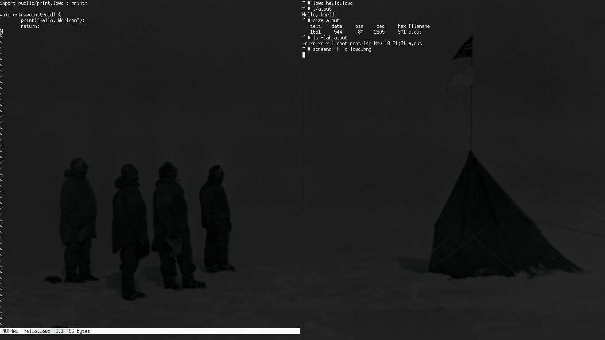

# Krzysztof Marciniak

## Software I Use Daily

[wallpaper](https://en.wikipedia.org/wiki/Amundsen%27s_South_Pole_expedition)

- [mwm](https://github.com/KrzysztofMarciniak/minimal-window-manager) + [xxt](https://github.com/KrzysztofMarciniak/xxt) (with [Fixed](https://en.wikipedia.org/wiki/Fixed_(typeface)))  
- [s-nail](https://repo.or.cz/s-mailx.git)
- [mcabber](https://mcabber.com/)
- [rss89](https://github.com/KrzysztofMarciniak/rss89)
- [jvi](https://github.com/KrzysztofMarciniak/jvi)
- [cpass2](https://github.com/KrzysztofMarciniak/cpass2)
- [screenc](https://github.com/KrzysztofMarciniak/screenc)
- [jbi](https://github.com/KrzysztofMarciniak/jbi)
- [wk](https://github.com/KrzysztofMarciniak/wk)
- [web](https://github.com/KrzysztofMarciniak/web)
    
## Featured projects

| Project | Overview | Shields.io |
|---|---|---|
| [Lucid Kernel](https://github.com/KrzysztofMarciniak/Lucid-Kernel) | [WIP] Tiny non-POSIX x86 hobby OS built on KISS principles. The user ABI is just two syscalls, path-based read and write, and every other kernel service is a virtual file. Ships a preemptive kernel, Brain tiling WM, Eye terminal and Clearsh Lisp shell, with hard budgets of a 1 MiB kernel and a 10 MiB bootable ISO. Runs on real ThinkPad X201 hardware. |         |
| [Simple Linux](https://github.com/KrzysztofMarciniak/Simple-Linux/) | [WIP] KISS, developer-first Linux distribution built from source, with three planned profiles (Bare, Minimal, Minimal + X11). Built on musl, BusyBox, LLVM/Clang and the Ark source-based package manager. |         |
| [lowC](https://github.com/KrzysztofMarciniak/lowC) | C-like systems language and compiler with explicit-width integers, structs, pointers, modules and inline assembly. Targets x86-64. |       |
| [mwm](https://github.com/KrzysztofMarciniak/minimal-window-manager) / [mwm+](https://github.com/KrzysztofMarciniak/minimal-window-manager-plus) | Dynamic X11 tiling window managers in C. mwm is a single-file core under 500 lines with nine workspaces; mwm+ adds borders, gaps and a status bar. |        |
| [xxt](https://github.com/KrzysztofMarciniak/xxt) | Extremely small X11 terminal emulator written in C. Uses under 1.6 MB of memory at runtime, with a 408-line implementation and minimal dependencies. |       |
| [ScholarVault](https://github.com/KrzysztofMarciniak/ScholarVault) | Scientific publishing platform with a Laravel 12 REST API and a single-page frontend. Supports author, reviewer and admin roles, versioned submissions and a peer-review workflow. |       |
| [oopdbms](https://github.com/KrzysztofMarciniak/oopdbms) | NoSQL database with an object-oriented model: classes, inheritance, interfaces, pointers and class-owned functions. Ships a CLI and an embeddable C engine library. |        |
| [Civet](https://github.com/KrzysztofMarciniak/civet) | Compact C89/POSIX HTTP static file server (GET and HEAD) with an in-memory virtual filesystem and optional file caching. About 70 KiB (text + data + bss, x86-64, musl). |        |
| [Ark](https://github.com/KrzysztofMarciniak/Ark) | Small Linux package manager for offline-first, rootless, source-based software installation, including air-gapped environments. |        |
| [ct](https://github.com/KrzysztofMarciniak/ct) | X11 terminal emulator built with clay.h, with inline image (PNG, JPEG, WebP) and video (libmpv) support. |        |

## More projects

### Data and libraries
| Project | Overview | Shields.io |
|---|---|---|
| [oopdbmsc](https://github.com/KrzysztofMarciniak/oopdbmsc) | Embedded POSIX C99 library for [oopdbms](https://github.com/KrzysztofMarciniak/oopdbms). Link it into a C program, open an `.oopdb` file and run OOPDBMS commands directly, with no server or subprocess. |        |
| [scjson](https://github.com/KrzysztofMarciniak/scjson/) | Small dependency-free C99 JSON library: parsing and validation, in-place modification, compact and pretty serialization, manual construction, and parse errors with line and column. |       |
| [CppJsonDB](https://github.com/KrzysztofMarciniak/CppJsonDB) | Educational SQL database engine in C++ that stores data as JSON files. Supports SELECT/INSERT/UPDATE/DELETE, INNER/LEFT/RIGHT/FULL joins, user authentication with per-database permissions, file-based locking and a REPL. |        |
| [img](https://github.com/KrzysztofMarciniak/img) | Minimal C99 X11 image viewer for PNG, JPEG and WebP, built to be smaller than feh and nsxiv. About 16 KB, with prebuilt static binaries in the releases. |        |
| [256avatars](https://github.com/KrzysztofMarciniak/256avatars) | Go library for generating random, symmetric and key-based black-and-white pixel-art avatars. Renders PNGs and generates HTML tags for web apps. |       |
| [sanitizec](https://github.com/KrzysztofMarciniak/sanitizec) | Rule-based string sanitization library in C for web development. Combinable bitmask rules cover XSS escaping, SQL keywords, directory traversal, URL encoding and character allowlists. Make and Ninja builds, optional memoization cache. |        |
| [cpass](https://github.com/KrzysztofMarciniak/cpass) | Minimal C alternative to the `pass` password manager, built with OpenSSL. Command-line interface with init, add, delete, edit and list. |        |
| [jwtc](https://github.com/KrzysztofMarciniak/jwtc) | Minimal C library for generating and validating HS256 JWTs, using OpenSSL and json-c. |        |
### Languages, systems, and tools

| Project | Overview | Shields.io |
|---|---|---|
| [jbi](https://github.com/krzysztofMarciniak/jbi) | A small C99 tool and library that detects a project’s build system, ranks candidates using build commands in its docs, and tries them until one works. Otherwise it autobuilds C/C++ sources. |   |
| [pm](https://github.com/KrzysztofMarciniak/pm) | A C99 command-line project generator with a reusable static library. It creates C or C++ projects with Make, CMake, POSIX shell, configure, or Autotools build files.  |   |
| [redact](https://github.com/KrzysztofMarciniak/redact) | Tiny X11 tool for blacking out regions of PNG images while removing image metadata. |   |
| [wk](https://github.com/KrzysztofMarciniak/wk) | A tiny POSIX shell file-based kanban. Columns are directories, tasks are Markdown files, and numeric tiers determine task order. Manage everything with standard Unix tools. |   |
| [JCM](https://github.com/KrzysztofMarciniak/jcm) | Minimal Lisp language designed to be small enough to write and reason about on paper. |   |
| [Oczko](https://github.com/KrzysztofMarciniak/oczko) | Esoteric programming language with a Go interpreter, nested loops, scoped variables, conditionals, and Lisp-style prefix expressions. |   |
| [nil-lisp](https://github.com/KrzysztofMarciniak/nl) | Compact C99 Lisp interpreter with a foreign-function interface. |   |
| [Gentoo overlay](https://github.com/KrzysztofMarciniak/krzysztof-gentoo-overlay) | Personal Gentoo overlay with custom ebuilds and maintained package updates. |   |
| [screenc](https://github.com/KrzysztofMarciniak/screenc) | C screenshot utility using PNG and X11. |   |
| [openbsd-restrict-compilers](https://github.com/KrzysztofMarciniak/openbsd-restrict-compilers) | OpenBSD hardening tool to restrict compilers and interpreters to selected users. |   |
| [doom-mono-dark-theme](https://github.com/KrzysztofMarciniak/doom-mono-dark-theme) | Monochrome dark theme for Doom Emacs. |   |
| [php-cs-fixer.el](https://github.com/KrzysztofMarciniak/php-cs-fixer.el) | Minimal Emacs integration for PHP-CS-Fixer. |   |
| [org-diet.el](https://github.com/KrzysztofMarciniak/org-diet.el) | Diet-tracking utility for Emacs Org mode. |   |

### Web applications

| Project | Overview | Shields.io |
|---|---|---|
| [Discord Bot Control Panel](https://github.com/KrzysztofMarciniak/dc) | Self-hosted Go dashboard for managing Discord bots, scheduled messages, and automated replies, with SQLite storage. |   |
| [Go AlpineJS MongoDB Stack](https://github.com/KrzysztofMarciniak/go-alpinejs-mongodb-stack) | Full-stack template combining Go, AlpineJS, Handlebars, MongoDB, and observability tools. |   |
| [busybox-crud-website](https://github.com/KrzysztofMarciniak/busybox-crud-website) | CRUD website built on an Alpine Linux stack. |   |
| [honeypot-go-php-apache](https://github.com/KrzysztofMarciniak/honeypot-go-php-apache) | Dockerized honeypot that emulates a legacy PHP/Apache service. |   |
| [lua-openresty](https://github.com/KrzysztofMarciniak/lua-openresty) | Lua-based template HTTP server using OpenResty. |   |

## Articles

| Article | Link |
|---|---|
| *What Linux Means to Me* | [Read the PDF](https://github.com/KrzysztofMarciniak/What-Linux-Means-to-Me/blob/master/main.pdf) |
| *Design and Implementation of mwm and mwm+: Minimal X11 Tiling Window Managers in C* | [DOI: 10.5281/zenodo.15824542](https://doi.org/10.5281/zenodo.15824542) |
| *Dual-Model Simple Cache (DMSC) and Triple-Model Adaptive Routing (TMAR): Multi-Model Optimization* | [DOI: 10.5281/zenodo.14957147](https://doi.org/10.5281/zenodo.14957147) |

## Certifications

- **IT Technician (351203)** — INF.02 and INF.03 vocational diploma.
- **Certified IT Security Specialist (CISS)** — Certificate no. 000509, [Akademia Bezpieczeństwa](https://ciss.akademiabezpieczenstwa.pl).

## Profiles

| Platform | Profile |
|---|---|
| Exercism | [Krzysztof Marciniak](https://exercism.org/profiles/KrzysztofMarciniak/solutions?order=newest_first) |
| LeetCode | [krzysztofmarciniak](https://leetcode.com/u/krzysztofmarciniak/) |
| TryHackMe | [KrzysztofMar](https://tryhackme.com/p/KrzysztofMar) |
| GitLab | [krzysztofmarciniak](https://gitlab.com/krzysztofmarciniak) |
| LinkedIn | [Krzysztof Marciniak](https://www.linkedin.com/in/krzysztofmarciniakit/) |
| Crowdin | [krzysztofmarciniak](https://crowdin.com/profile/krzysztofmarciniak) |

## Gist

- [AI prompt for generating Anki math flashcards with LaTeX formatting](https://gist.github.com/KrzysztofMarciniak/c11bdede6f659bbcc890de7595318409)
